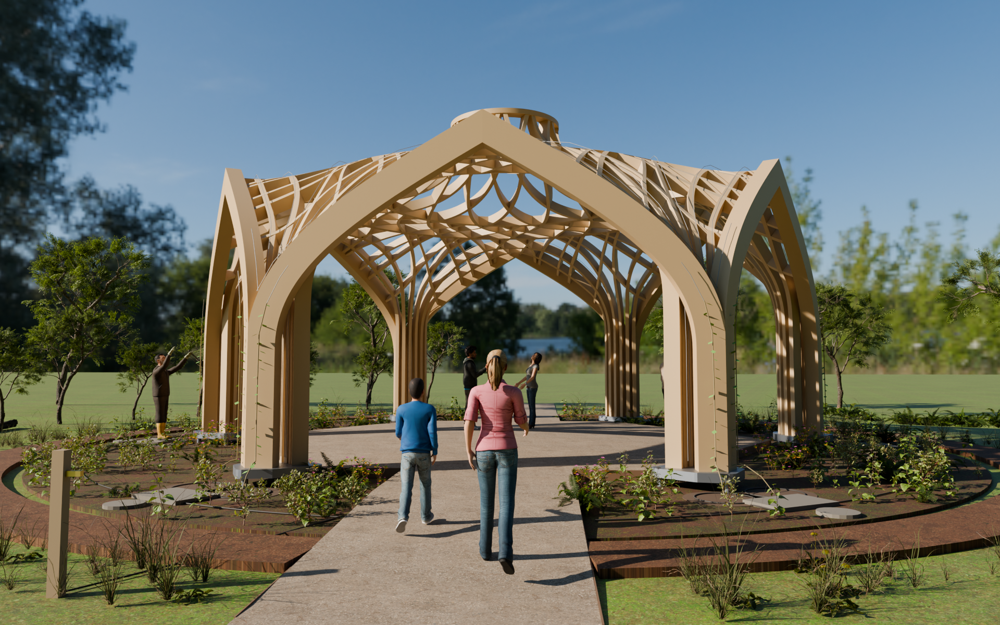
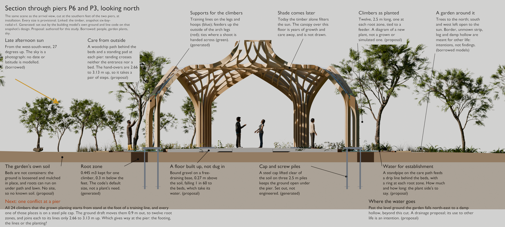
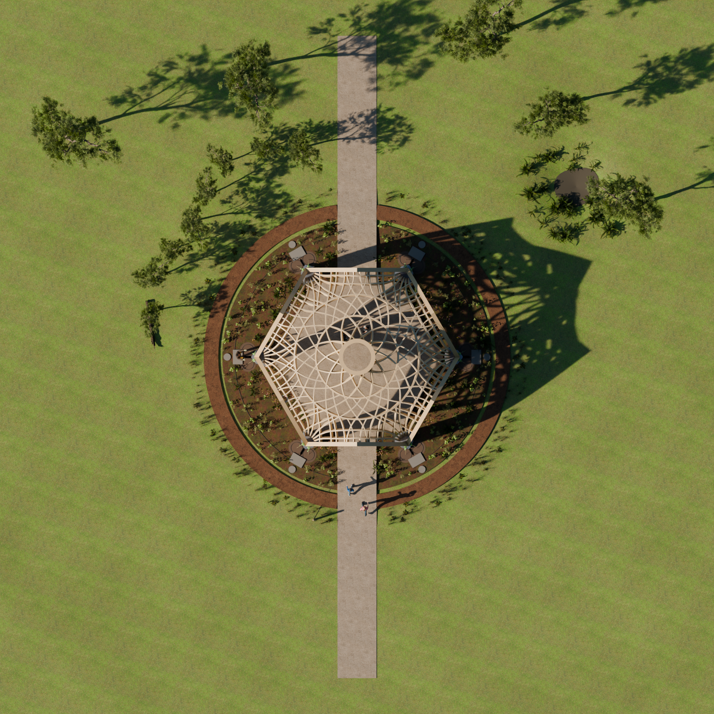

# Inhabited room: the six-bay Bower as a place, at installation

A first scene study for [docs/fable-first-scene.md](../../../docs/fable-first-scene.md). One editable
Blender scene puts the existing six-bay room on ground: an approach, a floor, planted edges, rooting
soil, footings, the plants' way up, water, a way round for care, a garden and people. Two views are
taken from that one scene, and the study ends in one question at a pier.

| | |
|---|---|
|  | `views/arrival.png`, camera `CAM_arrival`: the eye of someone arriving from the south, 1.6 m above the path. |
|  | `views/section.png`, camera `CAM_section`: the same scene cut at the southern feet of piers `R1.P6` and `R1.P3`, looking north. |
|  | `views/plan.png`, camera `CAM_site_plan`: the layout from above, north up, for checking the two against each other. |

Nothing here is measured from a real Bower, and nothing in the scene is simulated growth. Every size
is provisional. No foundation is engineered, no soil is known, and no horticultural requirement is
claimed.

## Four kinds of thing

Every object in the scene carries `study_status` and `study_note` (Object properties > Custom
Properties). The section's labels use the same four words.

| Kind | What it covers | Where it comes from |
|---|---|---|
| linked | The timber (111 members) and the snapshot's nine cameras. | `releases/six-bay-radial-v1/bower.blend`, by a relative link. Unchanged. |
| generated | Pile caps, screw piles, root zones, training lines, feeders, hand-overs. | `ground.json`, written by `set_out_ground.py`: the building model's own `bower/ground.py` and `bower/lines.py`, run unchanged on the snapshot's frozen design. |
| proposal | Levels, floor, paths, steel edge, beds, the climbers as planted, care path and pads, standpipe, drip line, the fall of the ground and the hollow, cameras, labels. | Authored for this study in `site.json`. Change a number and build again. |
| borrowed | People, garden plants, ground textures, the sky. | `assets.json`: Poly Haven (CC0) and Microsoft Rocketbox (MIT). Not Bower geometry and not Bower planting. |

There is no fifth kind. Simulated behaviour is not in the scene: the climbers are diagrams of a newly
planted stem, and the grown plantings of `drawings-in-code` are used only as data (which taxon the
planting puts at which pier, and where it roots them). Nothing has been measured or observed.

## Baseline

`six-bay-radial-v1`, because `drawings-in-code/snapshot.json` selects it: the grown plantings, the
plates and the deck already stand on it. `v2` only recuts 18 laps. `open-pier` is a study and is the
next thing to bring to this scene, not its starting point.

What was found on inspection:

- The Blender that was running held an unsaved panel session on the eight-bay model, opened from the
  old folder (`C:\BOWER\bower-blender\output\bower_v1.blend`). It was read and left alone. The study
  was built and rendered in a second, windowless Blender (`run_headless.ps1`).
- The snapshot's materials carry a viewport colour and nothing a path tracer can use, and a linked
  material cannot be edited. So `BOWER_V1` is linked whole, as `releases/README.md` describes, and
  its timber is shown through `S05_BOWER_TIMBER`: local objects with the members' own names and
  properties, on the same linked meshes, with study materials in each family's own colour. The
  source cameras (`70_CAMERAS`) are in the scene as linked.
- `design.json` is the eight-bay room now, and its `ground` block is the draft at that room's
  `R1.P6`. The six-bay snapshots carry no root zones and no training lines.

## The ground code, run on this room (generated)

`python set_out_ground.py` runs `ground.beside_pier` at all six piers and then `ground.lay`. On
`six-bay-radial-v1` it gives:

| | |
|---|---|
| Root zones | 12, one outside each arch leg: 0.5 m radius, 0.6 m deep, 0.45 m3 each, 0.3 m below the feet. 4 to 6% of each lies under a cap. |
| Footings | 6 steel caps of 0.92 to 0.93 m2, each on 3 screw piles 2.5 m long: 18 piles. |
| Training lines | 24, on the hoops and the lattice legs that stand on the floor: 238 m of cable. |
| Feeders | 20 cables, 42 m, up the outside of the arch legs. |
| Hand-overs | 36, between 2.66 and 3.13 m above the floor, with ties of 0.24 to 0.39 m. |
| Line a plant from outside cannot use | 101 m of the 238 m: everything below the hand-overs. |
| Entrances | 5.6 m between arch legs, 5.0 m between root zones, in every bay. |

Three things it shows that the eight-bay draft did not:

1. **The grown planting stands on the footings.** `drawings-in-code` roots its 24 climbers at the feet
   of the training lines (`scenes/six-bay-radial-v1/bower.json`, stations `bed.R1.P*.*`). All 24 of
   those places lie inside a pile cap's outline, by 0.17 to 0.30 m, and 0.87 to 0.91 m from the
   nearest root zone the ground draft allows.
2. **Two piers lose a cable.** The room is the same at all six piers, but the feeder on the arch's
   back comes out at `P1`, `P2`, `P4` and `P5` and not at `P3` and `P6`, where the hand-overs are
   still measured from it. That is a fault in the draft code, recorded here and not fixed: this study
   does not change the building model. The section is cut through exactly those two piers, so its
   red feeders stop at the top of the arch leg.
3. **The open pier is worse on this footing.** The same code on `six-bay-radial-open-pier` puts each
   pier on a single cap of 2.35 m2 (two and a half times the area), lifts the hand-overs to 3.38 to
   3.68 m, and finds no hand-over within reach for eight of each pier's lines. Its entrance measure
   still reads 5.6 m, because that measure counts arch legs and root zones only: the lattice legs
   that the open pier moves into the bay are not in it.

## Decisions (proposals, all in `site.json`)

Each was made to be argued with, and each is one number or a few.

- **Orientation and route.** The entrance bay `R1.B1` faces south. One straight route runs through
  to `R1.B4` in the north. Those two bays are walked through; the other four are planted across,
  open to look through and not to walk through.
- **Levels: the floor is raised, the garden stays where it is.** `ground.py` leaves open whether the
  feet are raised or each pier stands in a sunken bed. This study takes its soil level (0.3 m below
  the feet) as the garden's level everywhere and builds the floor up 0.27 m on the stripped ground:
  bound gravel on a free-draining base, held by a steel edge, falling 1 in 60 from the middle to the
  beds. Nothing is dug where roots are wanted. It costs a ramp of 1 in 20, 3.6 m long, at each end,
  and a drop of 0.2 m from floor to bed all round.
- **Floor.** A hexagon with its corners 0.9 m short of the piers: 9.2 m across, about 73 m2. Every
  pier therefore stands in a bed, and the planted edge comes 0.8 m into the room under each arch.
- **Entrance.** A path 2.4 m wide through an arch 5.6 m between its legs, so 1.6 m of planting
  either side of the way in.
- **Beds.** Two crescents, east and west, each round three piers, 2.1 m deep beyond the piers. They
  are the garden's own soil loosened and mulched in place, not containers. Each root zone is kept
  clear; the rest has low planting, sparse, as newly planted.
- **Climbers as planted.** Twelve, 2.5 m long, one at each root zone, tied to the nearest feeder.
  Each zone carries the taxon that the drawings' planting sends over the roof from that pier
  (wisteria at `P2`, `P4`, `P6`; vine and akebia at `P1`, `P3`, `P5`). That is a label carried
  across, not a check that the plant suits the place.
- **Care.** A woodchip path 0.9 m wide round the back of each bed, leaving the approach on the ramp
  3.5 m short of the entrance. From it, one stepping pad leads in to a standing pad outside each
  pier, between its two root zones. Tending then crosses neither the entrance nor a bed.
- **Water.** A standpipe where the care path leaves the approach; a drip line round the back of the
  beds with a ring at each root zone and a sleeve under the path. The floor sheds to the beds.
  Beyond the level ground (10.5 m from the middle) the garden falls north-east at 3% to a hollow
  0.4 m deep.
- **Garden.** Five trees to the north, behind the room as you arrive, leaving the south and west
  open to the sun. A border of large shrubs to the north-west backs the care path; it was first
  drawn to the west, where the plan showed it shading the west bed in the afternoon. A strip
  1 m wide is left unmown outside the care path, and a log is left by the border. The border, the
  strip, the log and the hollow are meant for other life. Those are intentions, not findings.
- **People, no furniture.** Six figures: two arriving, two talking in the middle (one looking up into
  the crown), one pausing at the planted edge, one tying in a shoot at the west pier.
- **Light.** The sky is a photograph, mirrored and turned so that its sun stands in the
  west-south-west, 27 degrees up, with its open side behind the room. No date or latitude is
  modelled, and no shade study has been made.

## The conflict to resolve next: `R1.P1`, the pier on the left of the entrance

At this pier four things want the same square metre and the existing work answers them differently.

- **The planting we have grown and filmed** starts four climbers here, each within 0.18 m of the leg
  it climbs. All four places are on the steel cap (0.93 m2) that the footing draft puts under the
  pier, 0.17 to 0.30 m inside its edge.
- **The footing draft** therefore roots plants outside: two zones, not four, 0.9 m further out, with
  soil 0.3 m below the feet.
- **The lines** those plants are meant to climb start in the pocket behind the arch legs. From a root
  zone a shoot goes up a feeder on the arch leg and is handed across by a gardener between 2.66 and
  3.13 m up. Below that, about 2.6 to 3.1 m of each of the pier's six lines is cable no plant from
  outside can use.
- **The entrance and care.** One of the two zones (`R1.P1.root.1`) lies beside the way in, 1.3 m from
  the path's edge and 0.2 m below it. The hand-overs need a pair of steps, standing on ground the
  roots would otherwise have.

**Which gives way: the footing, the lines or the planting?** The footing could open (a foot for each
leg with soil between, which is what the open-pier study is reaching for, though on the present cap
it comes out worse); the lines could come down the outside to where a plant can be put; or the
planting could become two plants a pier, rooted outside, which the grown runs have not tried. Each
changes the entrance, the bed and the care in this scene, and the scene is built so that the change
can be made in one place and seen in both views.

## Assets borrowed, and what could not be had

`python fetch_assets.py` downloads them (87 files, 152 MB) into `assets/`, which is not in git;
`assets.lock.json` records every file, its source address, size and MD5.

| Source | Licence | Used for |
|---|---|---|
| [Poly Haven](https://polyhaven.com): `meadow_2` (HDRI, 2k) | CC0 | sky, sunlight, the distant trees |
| Poly Haven: `pebble_ground_01`, `leafy_grass`, `brown_mud_leaves_01`, `wood_chip_path` (1k) | CC0 | floor and paths, lawn, bed surface, care path |
| Poly Haven: `tree_small_02`, `shrub_01`, `shrub_04`, `fern_02`, `periwinkle_plant`, `dandelion_01`, `grass_medium_02`, `dead_tree_trunk` (1k) | CC0 | garden trees and border, low planting on the beds, the hollow, the unmown strip, the log |
| [Microsoft Rocketbox](https://github.com/microsoft/Microsoft-Rocketbox): six avatars | MIT | the people |

How they are used: the Poly Haven models are linked from their own `.blend` files by relative path
and instanced (one geometry-nodes scatter per kind, collection instances for the trees). The figures
are imported, posed by turning their joints (`POSES` in `build_scene.py`) and textured from colour
maps reduced from 2048 px to 1024 px.

What was looked for and not used:

- **Local libraries.** Blender's one configured asset library points at a folder that does not exist,
  no asset add-on is installed, and nothing under `C:\BOWER` is a reusable scene asset.
- **The Higgsfield connector's 3D catalogue.** It imports only into its own cloud project, states no
  licence, and the standing rule is no paid generation without permission. Not called.
- **People on Poly Haven.** There are none, hence Rocketbox. Its figures are game-quality and stiffly
  posed. They show scale and use; they are not portraits of anyone.
- **Temperate trees and hedge-sized shrubs.** Poly Haven has neither by name. One small deciduous
  tree stands in for every tree and, scaled down, for the border; the low plants are small
  herbaceous models enlarged 1.2 to 2.2 times. None is a species choice.

## Opening, changing, rendering

```
python fetch_assets.py                      # once: the borrowed assets
python set_out_ground.py                    # after changing the snapshot: writes ground.json
.\run_headless.ps1 --render arrival,section,plan --samples 110
```

`build_scene.py` starts from an empty file each time and writes `inhabited_room.blend`; it refuses
to run over any other open file. To work by hand, open `inhabited_room.blend`: all links are
relative (`//../../../releases/...`, `//assets/...`).

Collections: `BOWER_V1` (linked), then under `STUDY_inhabited_room`: `S05_BOWER_TIMBER`,
`S10_TERRAIN`, `S20_ROOM_GROUND`, `S30_BEDS`, `S40_FOUNDATIONS`, `S45_SUPPORTS`,
`S50_BOWER_PLANTING`, `S60_WATER`, `S65_CARE`, `S70_GARDEN`, `S80_PEOPLE`, `S90_CAMERAS`,
`S95_SECTION_NOTES`, `S99_ASSET_SOURCES`.

Cameras: `CAM_arrival`, `CAM_section`, `CAM_site_plan`, and the snapshot's own nine (`CAM_exterior`,
`CAM_interior`, ...), linked.

**The section is a switch, not a second scene.** The node group `STUDY_section_switch` holds
`section_on` and `section_y`. At 1, every study material hides what lies south of the cut and paints
the inside of each solid it has cut a flat colour, and `CAM_section`'s near clipping plane cuts
everything borrowed at the same place. `render()` sets it for the section and puts it back, so the
file is saved inhabited. By hand: set `section_on` to 1, look through `CAM_section`, and show
`S95_SECTION_NOTES`.

Three things in the section are drawn other than as they are. Cables are 8 mm thick where the real
one is 4 mm. Buried parts more than 2 m behind the cut are left out, so that the far piers' piles do
not appear to stand under the floor. And the cut soil is closed by a plane 2.5 m behind the cut
(`GR_cut_backing`), so that a tree's foot or a fern further north does not show through it.

**Another snapshot.** Change `baseline.snapshot` in `site.json`, run `set_out_ground.py`, then build.

## Not known, not done

- Whether a raised floor or sunken beds is right, and what a 0.2 m edge round the floor means for
  people with no furniture in the room.
- Anything about the foundations: loads, the arches' outward push, the piles beside loosened soil,
  the weight of a built-up floor near them.
- Whether roots can use the ground under the floor's edge, and what a standing pad does to the
  ground it sits on.
- How much water, how often, for how long; where the standpipe's supply comes from; whether the
  hollow can take what the floor sheds.
- Sun and shade at any real place and date. The trees are placed by a rule of thumb.
- What any of the garden's additions do for other life.
- The mature room. It is not drawn here; `drawings-in-code` grows it on the same snapshot.
